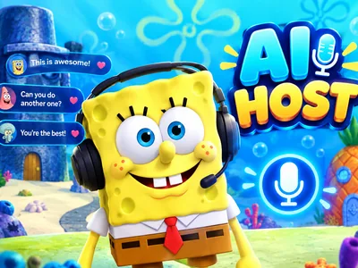
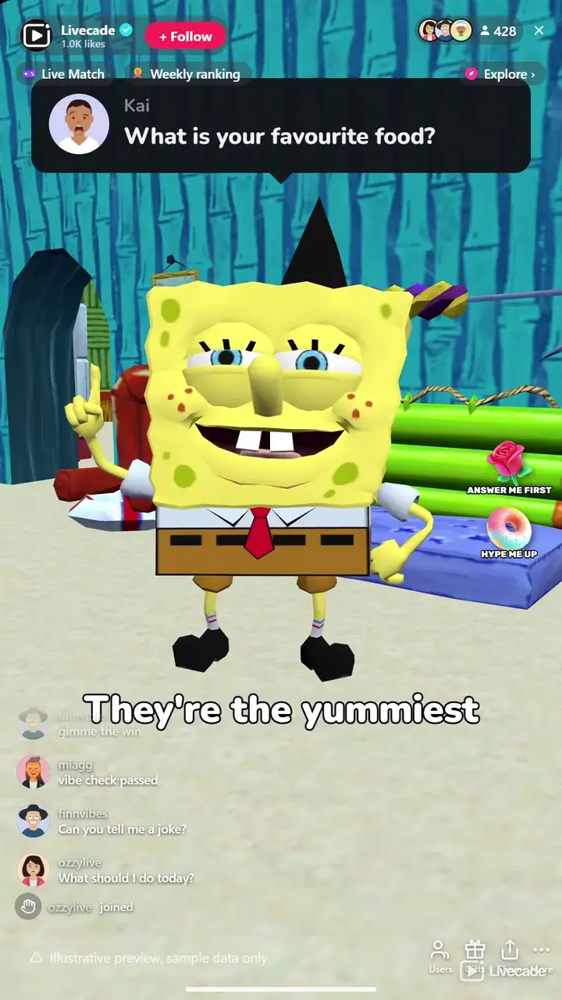

# AI Host - Interactive TikTok Live Game

> Your chat asks, the host answers out loud.

An AI co-host for your TikTok Live that answers your chat out loud, with a face that talks along and a voice of its own. It picks the comments worth answering, thanks gifts by name, and you choose how it looks and how it talks.

**[Play AI Host on Livecade](https://livecade.io/games/ai-host/?utm_source=github&utm_medium=readme&utm_campaign=ai-host)** - runs as a single browser source in OBS, Streamlabs, or TikTok LIVE Studio. Nothing for viewers to install.

## How viewers play

Viewers take part with the actions TikTok already gives them: **comments**, **gifts**, **likes**, **follows**, **shares**. Every action below is rebindable, so you decide which interaction drives which effect.

| Action | What it does |
| --- | --- |
| **Answer Me First** | Puts the sender's next comment at the front of the line, with the gift thanked in the answer |
| **Hype Me Up** | A longer personal shoutout that celebrates the sender by name |
| **Say My Name** | The host says hello to the viewer by name |

## How it works

### It answers chat out loud

The host picks the comment that makes the best moment and answers it in its own voice, with a talking face and the answer as captions.

### Your host, your way

Max as the orange Ember face or the blue Hologram, with the name, personality and voice you give him, or Santa by the tree.

### Gifts jump the line

A Rose puts the sender's question first, a Doughnut buys a personal shoutout, and every gift is thanked by name.

## About the game

AI Host puts a talking host on your stream that reads your chat and answers it out loud. It picks the comment that makes the best moment, writes a real answer in its own voice, and says it with a face whose mouth follows every word, while the answer runs as captions under it. When chat goes quiet it asks a question to get people typing again.

### Pick who hosts

Max is the host's own face, in orange or as a blue hologram, and you can rename him and pick his personality: friendly, playful, dry and witty, or high energy. Put your own picture behind him, and tell him what your stream is about. Or hand the show to Santa, who hosts from his armchair by the tree with his own voice and music.

### Gifts get their own moments

Out of the box a Rose puts the sender's question first and a Doughnut buys a personal shoutout, and every gift is thanked by name, a rush of them in one line. Any of these can be bound to likes, follows, shares or comments instead, and new followers can be welcomed too.

### You stay in charge

Press Answer this on any comment in your dashboard and the host takes it next. Give it a topic to talk about, a message to say in character, or have it ask chat a question. Tell it what the stream is about, what never to talk about and how you want it to talk. It always says it is an AI when asked, and it never asks your viewers for gifts.

## What it looks like on stream

[Watch AI Host gameplay](https://cdn.livecade.io/games/ai-host.mp4)

## What you can configure

- **Language** - Nine languages: English, Spanish, Portuguese, French, German, Russian, Italian, Turkish and Arabic
- **Look** - Ember (an orange face), Hologram (a blue one), or Santa in his armchair by the tree
- **Voice** - The host's own voice, or one you pick from the voice library. Use only voices you have the right to use
- **Background** - The host's own backdrop, or your own picture behind it
- **How the AI answers** - The host's name and personality, what the stream is about, what never to talk about, and your own instructions
- **What it answers** - Answer chat by itself or only what you pick, thank gifts, welcome new followers, and talk when chat is quiet
- **Pace** - No pause, 1, 2.5 or 5 seconds between answers
- **On screen** - The answer as captions, and the "Ask me anything" line while nobody is being answered
- **Who can play** - Everyone, followers only, or your fans club only

## Languages

English, Spanish, Portuguese, French, German, Russian, Italian, Turkish, Arabic

## FAQ

<strong>How does AI Host work?</strong>

Viewers comment in your TikTok Live chat as usual. The host picks a comment, writes an answer and says it out loud with a talking face, and the answer shows as captions. You can also press Answer this on any comment in your dashboard to have it answered next.

<strong>Can I choose how the host looks?</strong>

Yes. Max, the host's own face, comes in orange or as a blue hologram, and you can rename him, pick his personality and his voice, and put your own picture behind him. Or let Santa host from his armchair by the tree.

<strong>Is AI Host connected to any studio or show?</strong>

No. AI Host is Livecade's own game. It is not affiliated with, sponsored or endorsed by TikTok or by any studio, network or other rights holder.

<strong>Will it ask my viewers for gifts?</strong>

No. The host never asks for gifts, coins, likes or follows, even if your instructions say to. It thanks gifts when they arrive.

<strong>Does it say it is an AI?</strong>

Yes. Asked whether it is real, the host says plainly that it is an AI.

<strong>Can I keep it off some topics?</strong>

Yes. List the topics it should never talk about, and a comment about one of them gets a short, friendly pass instead of an answer.

<strong>How do I add AI Host to my TikTok Live?</strong>

Add one browser source URL to OBS or your streaming software and go live. There is no plugin to install and nothing for your viewers to download.

## Setup

1. [Create a Livecade account](https://app.livecade.io/register?utm_source=github&utm_medium=cta&utm_campaign=ai-host)
2. Copy your overlay browser source URL
3. Paste it into OBS, Streamlabs, or TikTok LIVE Studio
4. Pick AI Host, set your triggers, and go live

Runs in the browser, so it works on Windows and macOS with nothing to download. [See all TikTok Live games](https://livecade.io/tiktok-live-games/?utm_source=github&utm_medium=readme&utm_campaign=ai-host).

---

_This repository documents AI Host, a hosted interactive game by [Livecade](https://livecade.io/?utm_source=github&utm_medium=footer&utm_campaign=ai-host). The game runs on Livecade's platform, so there is no source to install here._
